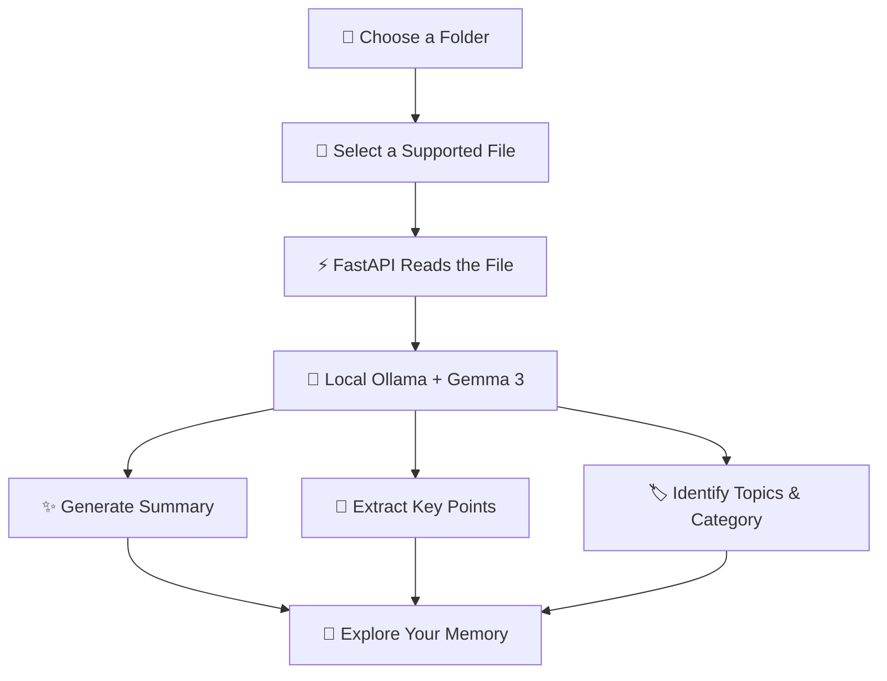

# 👻 Memory Ghost

<div align="center">

### Your files remember. Now your AI can help you, too.

**An open-weight AI memory assistant that brings forgotten files back to life.**

Turn scattered notes, documents, and text files into meaningful summaries, key insights, and searchable knowledge — powered by **Gemma 3 running locally through Ollama**.

<br/>


**[Features](#-features) · [How It Works](#-how-it-works) · [Quick Start](#-quick-start) · [Roadmap](#-roadmap)**

</div>

---

## 🌙 The Story Behind Memory Ghost

We all have digital ghosts.

Old lecture notes. Forgotten project files. Research documents buried in folders. Important information that we know we saved somewhere — but can't remember where.

**Memory Ghost gives those files a second life.**

Select a folder, choose a supported file, and let your local AI uncover its summary, topics, key points, and memory category. No hosted AI API is required for the core analysis workflow.

> 🕯️ *Your files hold the memories. Gemma helps you rediscover them.*

## ✨ Features

<table>
<tr>
<td width="50%">

### 🗂️ Folder Explorer
Choose a folder through the native folder picker and explore its files.

</td>
<td width="50%">

### 🧠 Local AI Analysis
Use Gemma 3 through Ollama to analyze supported text files on your machine.

</td>
</tr>
<tr>
<td width="50%">

### 📝 Intelligent Summaries
Transform lengthy text into concise, easier-to-review summaries.

</td>
<td width="50%">

### 🔑 Key Points & Topics
Extract important takeaways and identify the main subjects in a file.

</td>
</tr>
<tr>
<td width="50%">

### 🏷️ Memory Classification
Get an AI-generated category to help understand the type of information.

</td>
<td width="50%">

### 🔒 Local-First by Design
Avoid sending file content to a hosted AI API in the intended local Ollama workflow.

</td>
</tr>
</table>

## 👻 See the Workflow



The analysis workflow runs through your local backend and Ollama service. AI-generated results are displayed in the application for you to review.

## 🛠️ Built With

| Technology | Role |
|---|---|
| React + TypeScript | Interactive frontend |
| Vite | Frontend development and build |
| Python + FastAPI | Backend API |
| Ollama | Local model runtime |
| Gemma 3 (`gemma3:4b`) | Text analysis and summarization |
| SQLite | Initial database foundation for future persistent memories |

## 🖥️ Supported Files

| Format | Typical use |
|---|---|
| `.txt` | Notes and plain-text documents |
| `.md` | Markdown notes and documentation |
| `.json` | Structured text data |
| `.csv` | Tabular text data |

**Current analysis limits:** Files must be no larger than 1 MB, and the backend limits the text submitted for analysis to 12,000 characters. Longer content may be truncated.

## 🚀 Quick Start

Get your local Memory Ghost running in a few steps.

### 1. Requirements

Install:

- [Python](https://www.python.org/downloads/) 3.10+
- [Node.js](https://nodejs.org/)
- [Ollama](https://ollama.com/download)
- Git

### 2. Get the project

```bash
git clone https://github.com/Shikha18Shukla/LazyDesk-AI.git
cd LazyDesk-AI
```

> This repository currently contains the Memory Ghost adaptation.

### 3. Prepare the AI model

Start Ollama and download Gemma 3:

```bash
ollama pull gemma3:4b
```

Verify that it is installed:

```bash
ollama list
```

### 4. Start the backend

From the project root, open a terminal in PowerShell:

```powershell
python -m venv .venv
.\.venv\Scripts\Activate.ps1
python -m pip install -r backend\requirements.txt
python -m uvicorn main:app --app-dir backend --reload
```

Backend documentation: [http://127.0.0.1:8000/docs](http://127.0.0.1:8000/docs)

Health endpoint: [http://127.0.0.1:8000/api/health](http://127.0.0.1:8000/api/health)

### 5. Start the frontend

Open a **second terminal** in the project root:

```powershell
cd frontend
npm install
npm run dev
```

Open the local address printed by Vite, usually [http://localhost:5173](http://localhost:5173).

### 6. Bring your files back to life

1. Select a folder.
2. Choose a supported text file.
3. Run the AI analysis.
4. Review the summary, topics, key points, and memory category.

**Tip:** Start with a small, non-sensitive test file while checking your setup.

## 🔐 Privacy & Responsible AI

Memory Ghost is designed to run AI inference locally through Ollama.

- **Local inference:** The core analysis workflow uses your local model instead of a hosted AI API.
- **Explicit file selection:** You choose which folder and file to analyze.
- **Transparent processing:** The backend reads supported file content to generate its analysis.
- **Human review:** AI-generated information can be incomplete or incorrect, so review important results.
- **Responsible use:** Avoid processing sensitive documents unless you understand your local security configuration.

Local inference can reduce external data sharing, but it is not a guarantee of complete security. Protect your device, files, and local services.

## 🌍 Why Open-Weight AI?

AI should be something developers can explore, understand, and build with — not only consume through remote services.

Memory Ghost uses **Gemma 3** with **Ollama** to demonstrate how open-weight models can power practical applications on a personal computer.

Open innovation helps developers:

- 🧪 Experiment with AI systems and build new applications.
- 🛠️ Adapt tools to their own needs and workflows.
- 🔍 Learn from inspectable implementations.
- 🌱 Share improvements and encourage wider participation.
- 🔐 Explore local inference for workflows where external API dependence is undesirable.

This project is a small example of turning those possibilities into a useful, hands-on application.

## 🗺️ Roadmap

### ✅ Implemented

- [x] React and TypeScript workspace
- [x] FastAPI backend
- [x] Ollama connectivity check
- [x] Native folder picker
- [x] Supported-file listing and selection
- [x] Local Gemma 3 analysis
- [x] Summary, topics, key points, and memory category display
- [x] Initial SQLite database schema

### 🔮 Coming Next

- [ ] Save analyzed memories to SQLite
- [ ] Browse previously saved memories
- [ ] Search memories by keyword or topic
- [ ] Delete individual memories
- [ ] Add automated tests and robust error handling
- [ ] Package the app for desktop use

*The roadmap distinguishes the existing analysis workflow from features that still need implementation.*

## 🎬 Demo

**See Memory Ghost in action:** add your recorded demo link here before publishing.

If you are sharing a video, show the folder selection, the chosen test file, and the resulting AI analysis. Use a sample document without private information.

## 👩‍💻 About the Project

**Creator:** Shikha Shukla  
**Project:** Memory Ghost  
**Model:** Gemma 3 (`gemma3:4b`)  
**Inference runtime:** Ollama  
**Backend:** FastAPI  
**Frontend:** React + TypeScript

### Acknowledgment & Licensing

Memory Ghost was developed by adapting the [LazyDesk-AI repository](https://github.com/Shikha18Shukla/LazyDesk-AI).

The upstream README states that the repository does not currently specify a license. This acknowledgment does not grant permission to redistribute the original code. Resolve the licensing and attribution requirements before publishing a separate redistributed copy.

Gemma and Ollama also have their own applicable terms; review the relevant terms before distributing the application or model.

---

<div align="center">

### 🕯️ Don't let your knowledge disappear into digital clutter.

**Bring your files back to life with Memory Ghost. 👻**

*Built with curiosity, local AI, and a little Halloween magic.*

</div>
